<p align="center">
  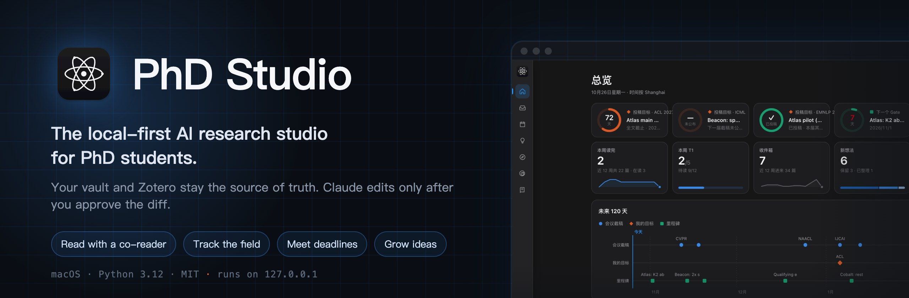
</p>

<p align="center">
  <a href="https://github.com/SongyuQi-Francisco/phd-studio/actions/workflows/tests.yml"></a>
  <a href="LICENSE"></a>
  
  
</p>

<p align="center"><b>English</b> · <a href="README.zh-CN.md">简体中文</a></p>

**PhD Studio** is a local-first research workbench for PhD students. Read papers with a Claude co-reader, keep a reading list that doesn't pile up, see every deadline on one timeline, follow your field, and grow ideas into research lines. It works on top of the Obsidian vault and the Zotero library you already have, and runs on your own Mac.

## Why

- **One place for the daily loop.** Reading, notes, the reading list, deadlines, peer tracking and ideas usually live in separate tools. Here they share one workspace and one vault, and a ⌘J assistant can act on all of them.
- **AI you can check.** Answers link to the page they rely on (`[p.4]`, `§3.2` jump in the PDF), a Claim Gate audit checks a note against the full text, every answer says which model wrote it, and a model is never swapped for another behind your back.
- **Your data stays yours.** The server listens on `127.0.0.1` only. Notes stay plain Markdown and YAML in your vault, Zotero stays the library, and Claude changes a file only after you approve the diff.

The interface is in Chinese; papers, notes and the code are in whatever language you use.

## Features

All screenshots use the fictional demo workspace from [`scripts/demo/make_demo.py`](scripts/demo/make_demo.py): invented research lines, scholars and labs, and well-known public papers.

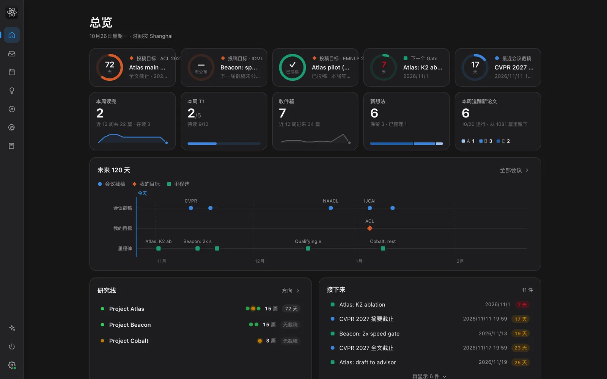

### Read with a co-reader

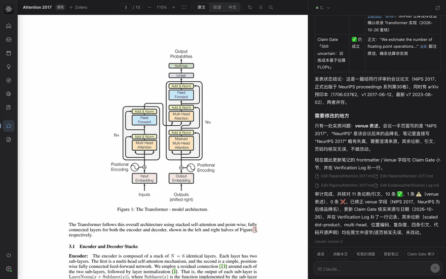

- **Select text** → 翻译 (translate, with DeepSeek, 智谱 GLM or Google; the engine is shown), 讲解 (explain), 问 Claude (ask), 摘录 (excerpt).
- **Crop a figure, table or formula** (⌥-drag or the crop tool) and the image itself goes to the model.
- **Excerpts** go into the paper's Obsidian note as `- "quote" [p.N] — comment`. You see the exact line before it is written, and can undo it.
- **Page and section links**: `[p.5]`, `pp. 4-5`, `§5.1` in notes and chat jump to that place in the PDF.
- **Claim Gate audit**: one click checks every claim in the note against the full text and primary sources, shows an audit table, then proposes note edits for your approval.
- **Bilingual PDF** of the whole paper with [pdf2zh-next](https://github.com/PDFMathTranslate/PDFMathTranslate-next) (formulas and layout kept), made in the background, optionally ahead of time for papers you mark T1/T2.
- **One persistent chat per paper**, resumed after restarts. Claude can read the vault, the paper's full text and the web.

| Crop a figure and ask: the image goes to Claude | Claim Gate: edits wait for your approval |
|---|---|
| 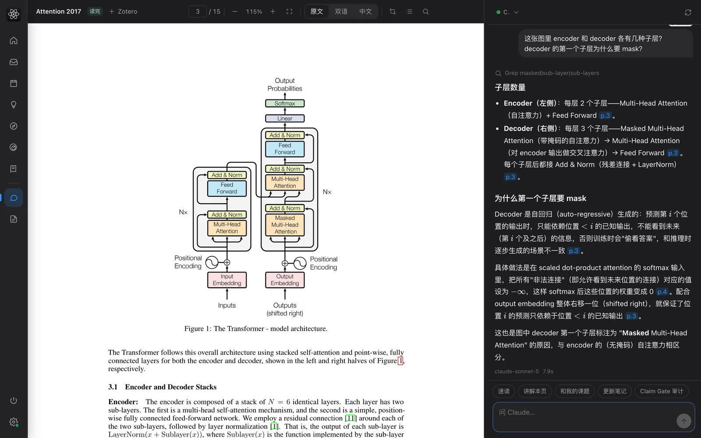 | 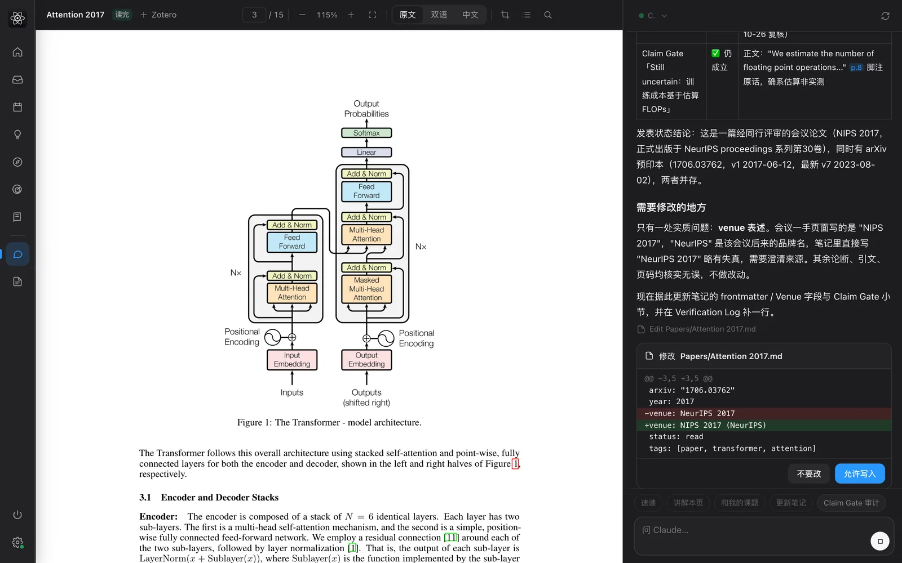 |
| **讲解: the answer links to the page it relies on** | **Note: page and section links jump in the PDF** |
| 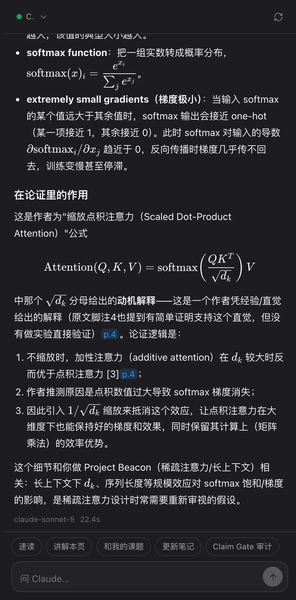 | 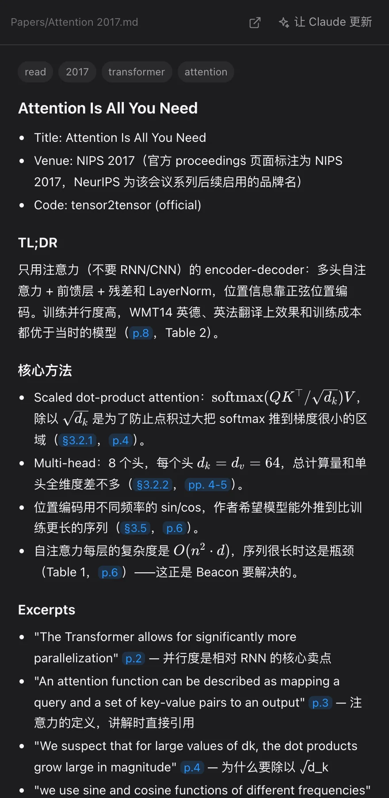 |
| **Bilingual PDF: original and translation side by side** | **Or the translation only** |
| 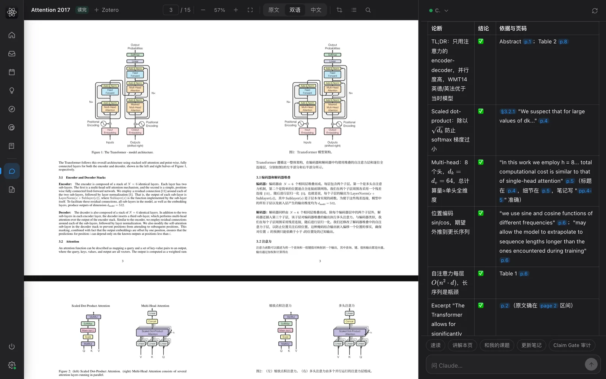 | 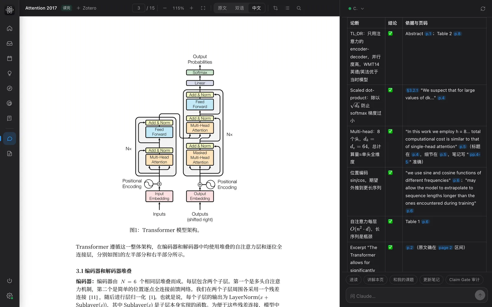 |

### A reading list that doesn't pile up

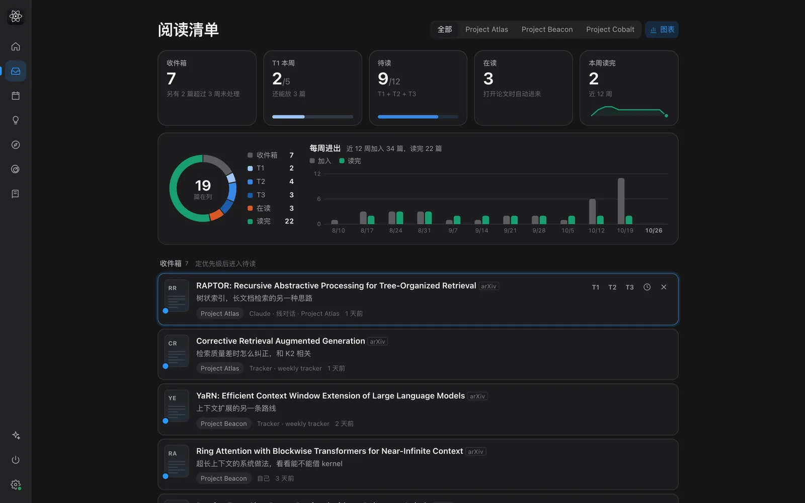

- `inbox → T1 / T2 / T3 → reading → done`, plus snooze and dismiss. Urgency is set before reading; depth, verdict and a one-line takeaway after.
- **Soft caps** against pile-up: 5 T1 papers and 12 queued, with a warning when you go over. Inbox items left for three weeks fold away.
- Every push records a date, a source and a required one-line reason. **Other AI sessions and scripts push through the CLI** (`./studio push --arxiv … --reason …`).
- **Zotero**: add the open paper in one click (through the Zotero desktop app, else the Zotero Web API with your own key), after a DOI / arXiv / URL dedupe.

### Deadlines on one timeline

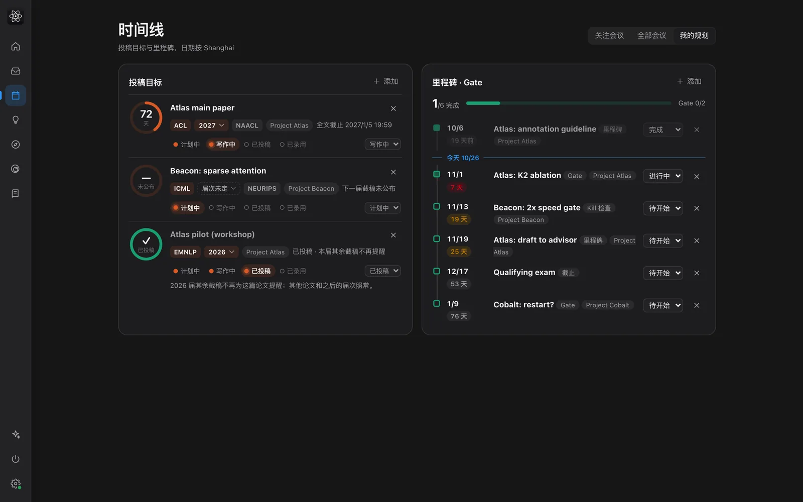

- A **venue library of 1048 conferences** with CORE (ICORE2026) and CCF ranks and per-edition deadlines from [ccfddl](https://github.com/ccfddl/ccf-deadlines), refreshed weekly.
- **16 key venues** carry details checked against their official CFP pages (tracks, page limits, review model), with a warning when they may be out of date. The assistant can re-check the official site and propose changes for you to confirm.
- **Targets are bound to an edition** (ACL 2027, not just "ACL"); a submitted paper silences reminders for that edition only. Venue deadlines, your targets and personal milestones, gates and kill checks share one timeline.
- **macOS notifications** before deadlines, with lead times, quiet hours, and one designated Mac so two machines don't both notify. A background check that also runs with the app closed (a LaunchAgent) is installed only from the button in Settings.

### Follow your field

| Top scholars (fictional in the demo) | Weekly lab radar |
|---|---|
| 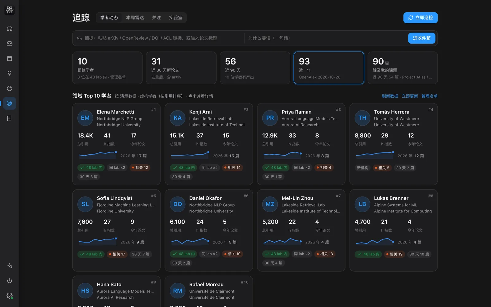 | 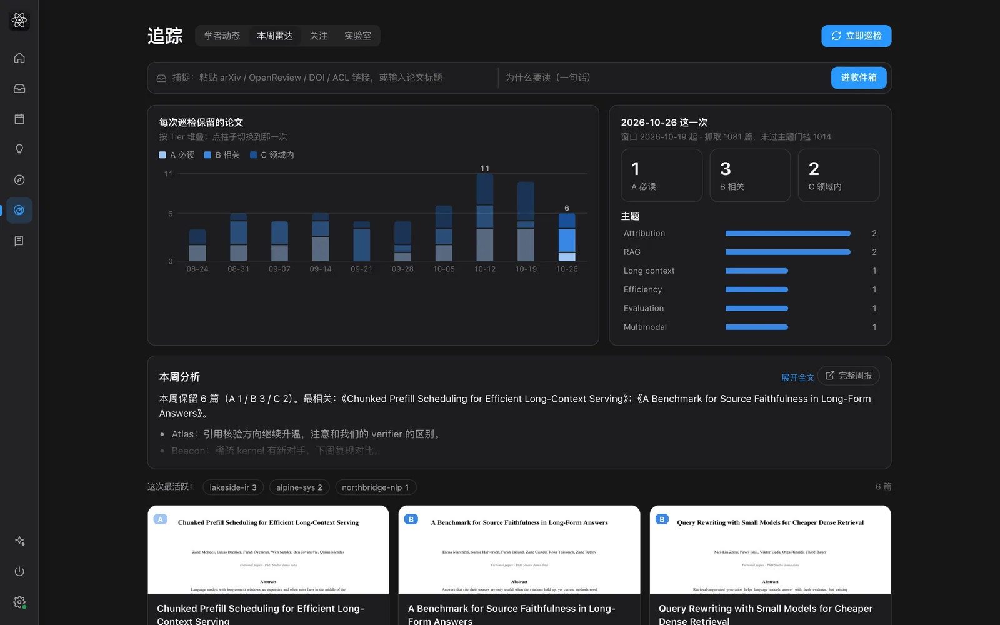 |

- **Top scholars and labs** of your field as cards and charts (OpenAlex and arXiv data, cached). The list is recomputed monthly from a Google Scholar ranking (sign-in and CAPTCHAs are left to you), and changes apply only after you confirm.
- **Weekly lab radar**: papers kept per run by tier and topic, with the weekly analysis. It reads the runs of a separate tracker project (`paths.tracker`, not part of this repository).
- **Follow keywords and people** across arXiv, OpenReview and the ACL Anthology.
- **Capture box**: paste an arXiv, OpenReview, DOI or ACL Anthology link, or type a title, and the paper lands in the inbox.

### Direction and ideas

| Roadmap and research lines | Ideas: tags, filters and merged ideas |
|---|---|
| 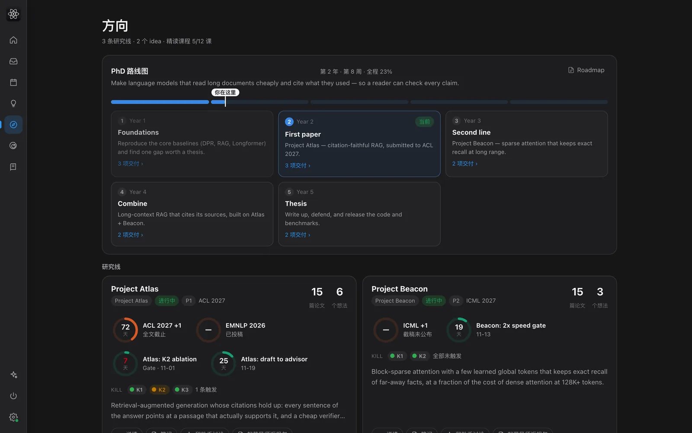 | 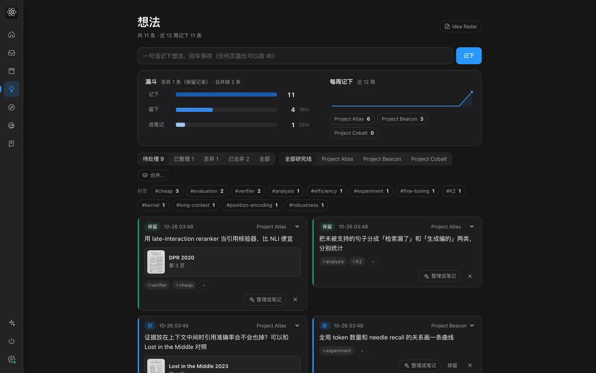 |

- **PhD roadmap** with a you-are-here marker, read from a note in your vault.
- **Research-line cards** with countdowns to their targets and **kill-criteria lights** (clear / partially triggered / triggered, read from the line's note).
- **A long-running chat per research line** and an **advisor report packet** drafted from a template.
- **Ideas**: ⌘I captures one with the paper and page you are on; free tags; merge several into one while keeping each original (restorable); promote one to a note.

### Assistant and models

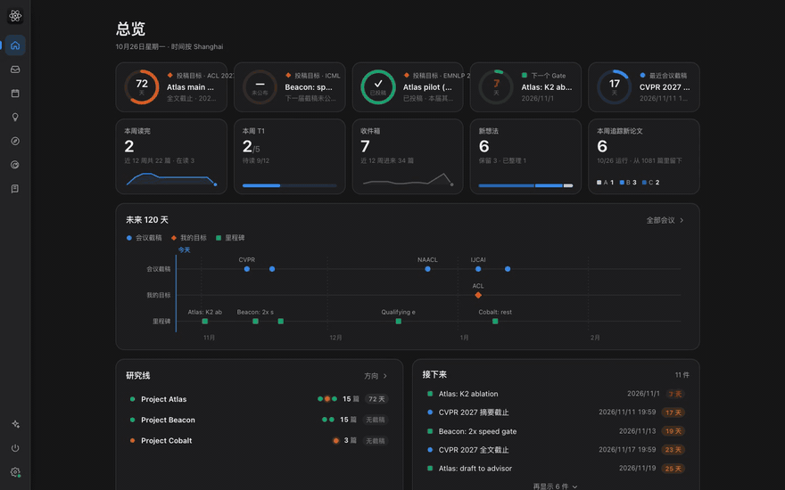

- The **⌘J assistant** sees the timeline, reading list and ideas, and can add to the list, the plan and the idea inbox.
- **Multi-model**: each chat can use Claude, Codex, Gemini, 智谱 GLM or DeepSeek. Only Claude may edit the vault, behind the diff approval; the others are read-only. An unavailable model fails with its own error and the fix, and every answer is labelled with the model that wrote it.

<p align="center">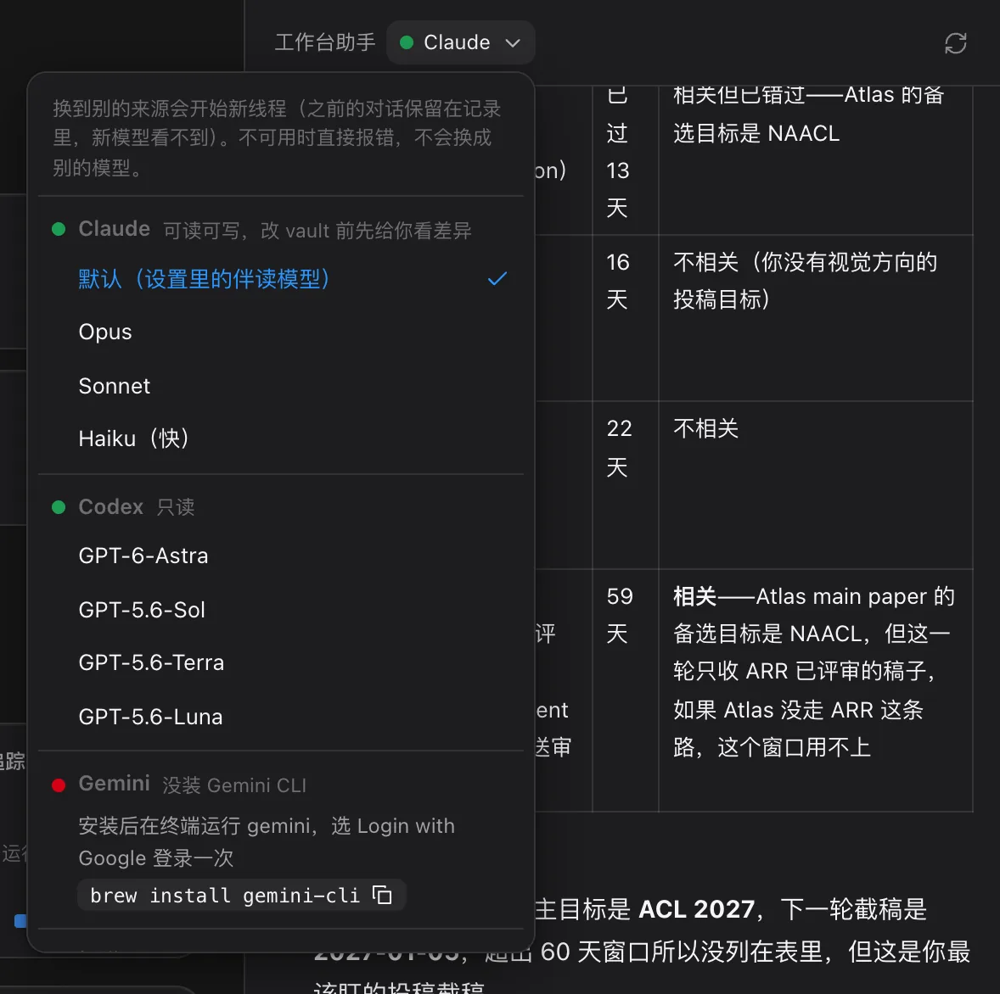</p>

## Quick start

**Requirements**

- macOS (the server and the tests also run on Linux; the desktop window and notifications are macOS-only)
- [uv](https://docs.astral.sh/uv/) (it installs Python 3.12 for you)
- A Claude subscription and the [Claude Code CLI](https://docs.claude.com/en/docs/claude-code) for `claude setup-token`
- Optional: an Obsidian vault and Zotero (any folder works as the vault), and the providers below

```bash
git clone https://github.com/SongyuQi-Francisco/phd-studio.git
cd phd-studio
uv sync
```

**Try the demo first.** It builds a fictional workspace in `~/Library/Application Support/PhD Studio Demo` (about 35 MB, mostly public arXiv PDFs):

```bash
uv run python scripts/demo/make_demo.py
STUDIO_CONFIG="$HOME/Library/Application Support/PhD Studio Demo/studio.toml" STUDIO_DEVICE=demo uv run uvicorn app.main:app --port 8790
```

Then open <http://127.0.0.1:8790>. Add `--secrets ~/.config/secrets` to `make_demo.py` to use your Claude login in the demo.

**Use it with your own vault.**

```bash
cp studio.example.toml studio.toml   # set your vault, Zotero and profile
./start.sh                            # http://127.0.0.1:8770
```

**Log in to Claude** with a long-lived token from your subscription:

```bash
claude setup-token
read -s "T?token: " && printf 'CLAUDE_CODE_OAUTH_TOKEN=%s\n' "$T" > ~/.config/secrets/claude.env && chmod 600 ~/.config/secrets/claude.env && unset T
```

**Desktop app (macOS).** `launcher/make_app.sh` builds `PhD Studio.app` on your Desktop: a small native launcher that runs the workbench in a WebKit window, so it shows up as "PhD Studio" in the Dock and ⌘Tab. Closing the window stops everything; logs go to `~/Library/Logs/PhD Studio.log`.

**Optional providers**, each set up on its own; whatever is missing shows its fix in Settings:

| Provider | Used for | Setup |
|---|---|---|
| DeepSeek | selection translation, bilingual PDFs, chat | `DEEPSEEK_API_KEY=…` in `~/.config/secrets/deepseek.env` |
| 智谱 GLM | selection translation, bilingual PDFs, chat | `ZHIPU_API_KEY=…` in `~/.config/secrets/zhipu.env` |
| Codex | chat (read-only) | Codex CLI, logged in with your ChatGPT plan |
| Gemini | chat (read-only) | Gemini CLI, logged in with Google (or `GEMINI_API_KEY` in `gemini.env`) |
| Google Translate | selection translation | nothing; used when no key is set |
| Zotero Web API | adding papers when the Zotero app isn't running | `ZOTERO_API_KEY=…` in `~/.config/secrets/zotero.env` |

Bilingual PDFs run pdf2zh-next through `uvx` in its own environment, downloaded on first use.

## Architecture

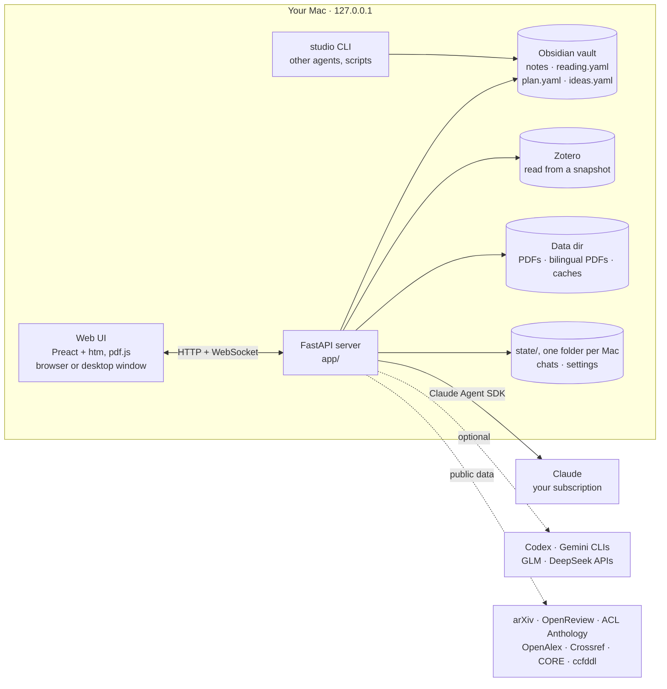

- **No build step.** Python (FastAPI) serves the API and the static frontend; Preact, htm, pdf.js, marked and KaTeX are vendored in `web/vendor/`.
- **Claude** runs through the [Claude Agent SDK](https://docs.claude.com/en/docs/agent-sdk/overview) with your own subscription. Its file edits go through a permission callback that shows the diff in the UI.
- **The CLI** (`./studio`) uses the same stores and the same locked, atomic writes as the app, with or without the server running.

## Privacy and data

- **Local-first.** The server binds to `127.0.0.1`. There are no accounts and no telemetry. Network requests go to the model providers you set up and to public sources (arXiv, OpenReview, ACL Anthology, OpenAlex, Crossref, the CORE portal, GitHub for ccfddl, publisher pages for PDFs); Google Translate only when it is the translation engine, Google Scholar only when you refresh the scholar list, and Zotero's Web API only when you add a paper with it.
- **Your vault and Zotero are the source of truth.** Zotero is read from a copy of its database, and a paper is added to it only when you click the Zotero button (or turn on its auto mode). In the vault, the app writes its own YAML files and a generated `Reading List.md`; an excerpt line or a `zotero:` link is written only after you confirm that exact line.
- **Diff approval.** Every edit Claude proposes is shown as a diff and applied only when you click 允许写入. Paths outside the vault are refused.
- **Two Macs.** The project and the vault can sit in a synced folder (Syncthing or similar). Chat state is per machine (`state/<hostname>/`), the reading list and the plan merge sync-conflict copies by themselves (newest edit per item wins), writes are atomic, and large PDFs stay in each machine's own data dir. Exclude the project's `.git` from sync (e.g. `/phd_studio/.git` in `.stignore` on each machine) and get code updates from GitHub; on the second Mac, run `launcher/make_app.sh` once to build its own launcher.

| What | Where |
|---|---|
| Notes, reading list, plan, ideas | your vault (plain Markdown and YAML) |
| Chat logs, session ids, settings | `state/<device>/` in the project (git-ignored) |
| Downloaded and bilingual PDFs, caches | `~/Library/Application Support/PhD Studio/` |
| API keys and tokens | `~/.config/secrets/*.env` |

## The `studio` CLI

Other agents and scripts can work with the same data:

```bash
./studio push --paper "Attention 2017" --tier T1 --line "Project A" --reason "what to look for" --by "planning session"
./studio push --arxiv 2606.17328 --reason "cited by X; check their metric" --by "weekly tracker" --source tracker
./studio list --status inbox
./studio done "Attention 2017" --depth deep --verdict key --takeaway "..."
./studio milestone "Draft experiments" --date 2026-11-15 --line "Project A" --kind gate
./studio idea "use X as a verifier for Y" --line "Project A" --tag verifier
./studio idea merge i1a2b3 i4d5e6 --text "..."
./studio target "Main paper" ACL --line "Project A"
./studio deadlines --days 90
./studio remind --check --dry-run
```

`--reason` is required for `push`, and papers already read or dismissed are not added again. Run `./studio <command> --help` for every option. Tell your agents about it in the vault rules file (e.g. `AGENTS.md`).

## Vault conventions

- One note per paper in the papers folder; YAML front matter may carry `arxiv:`, `doi:`, `zotero: zotero://select/library/items/KEY`, `source:`, `status:`, `year:`, `tags:`, `research_line:`.
- Research lines and ideas are notes with `type: research-line` or `type: idea` in the ideas folder, with sections such as `## One-line Pitch`, `## First Experiment` and `## Kill Criteria` (`- K1 …`).
- The roadmap note has `## Year 1: …` sections with `Goal:` and `Deliverables:`.
- An optional hand-written reading-queue note lists papers as `[[Note Name]]` under `##` sections; the app keeps its own `Reading List.md` next to it.
- An optional rules file (e.g. `AGENTS.md`) is given to Claude verbatim and must be followed for every edit.

The demo vault from `make_demo.py` shows all of these.

## Development

```bash
uv run pytest
```

1276 tests run against a throwaway vault, data dir and state dir created by `tests/conftest.py`, with the network blocked; your real vault, Zotero and `state/` are never touched. CI runs them on every push and pull request, and a PR needs the `tests` check to pass. See [CONTRIBUTING.md](CONTRIBUTING.md) for the workflow. `STUDIO_DEBUG=1 .venv/bin/python -m app.desktop` opens the desktop window with a local JS-eval hook for test scripts; don't use it otherwise.

Screenshots and clips for this README come from the demo: `scripts/demo/make_demo.py`, `scripts/demo/screenshots.py` (Playwright with the system Chrome) and `scripts/demo/readme_assets.py`.

**Code map:** `app/main.py` routes · `library.py` notes, Zotero, PDFs · `claude_chat.py` Agent SDK sessions and edit approvals · `providers.py` other models · `reading.py` the reading list · `plan.py` targets, milestones, ideas · `venues.py` the venue catalog · `tracking.py`, `scholars.py` the tracking page · `config.py` paths and settings · `web/` the frontend (`main.js` shell and reader, `chat.js` chat and note panels).

## Roadmap

What has shipped is in the [CHANGELOG](CHANGELOG.md). Planned work and bugs are tracked in [issues](https://github.com/SongyuQi-Francisco/phd-studio/issues); feature requests are welcome there.

Known limits today: the interface is Chinese only, the desktop window and notifications need macOS, and only Claude can edit the vault.

## Contributing

Contributions are welcome. Read [CONTRIBUTING.md](CONTRIBUTING.md) for the setup, the worktree + pull request + CI flow and the tests, and the [Code of Conduct](CODE_OF_CONDUCT.md). Report security problems privately as described in [SECURITY.md](SECURITY.md).

## License

[MIT](LICENSE). Vendored libraries keep their own licenses: Preact (MIT), htm (Apache-2.0), pdf.js (Apache-2.0), marked (MIT), KaTeX (MIT).
