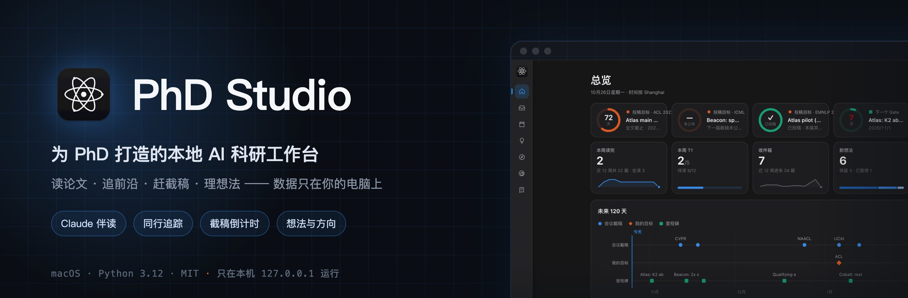
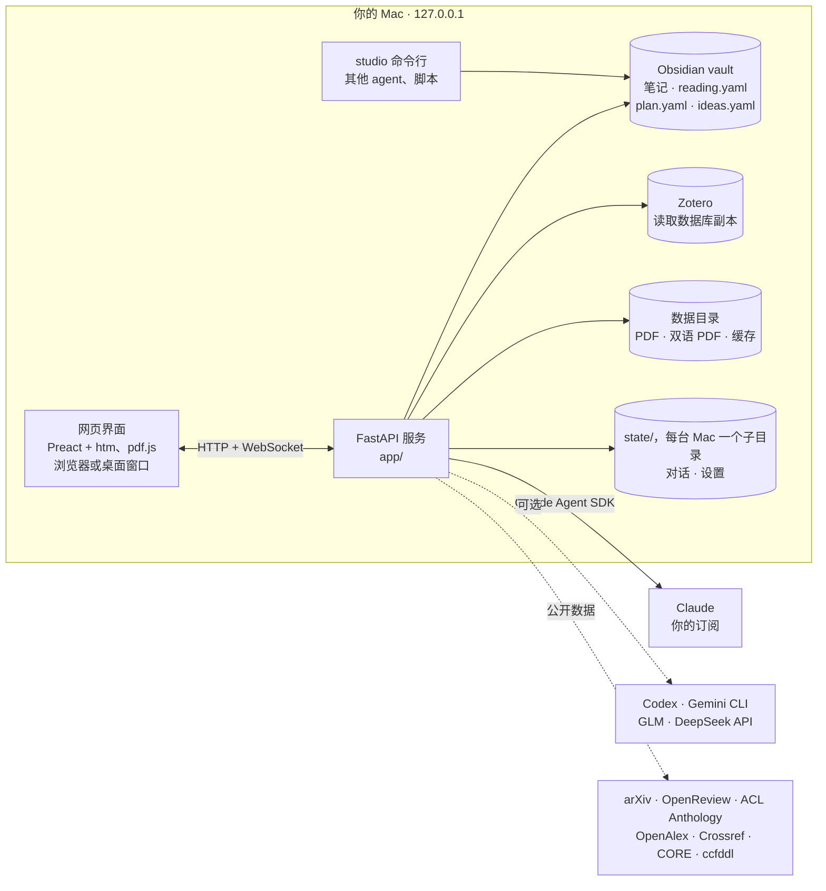

<p align="center">
  
</p>

<p align="center">
  <a href="https://github.com/SongyuQi-Francisco/phd-studio/actions/workflows/tests.yml"></a>
  <a href="LICENSE"></a>
  
  
</p>

<p align="center"><a href="README.md">English</a> · <b>简体中文</b></p>

**PhD Studio** 是为 PhD 打造的本地 AI 科研工作台：读论文 · 追前沿 · 赶截稿 · 理想法 —— 数据只在你的电脑上。

它建在你已有的 Obsidian vault 和 Zotero 文献库之上：Claude 伴读论文，阅读清单不会越堆越多，所有截稿在一条时间线上，同行动态一目了然，想法一步步长成研究线。

## 为什么做它

- **日常科研闭环放在一处。** 读论文、记笔记、阅读清单、截稿、同行追踪和想法，平时散在好几个工具里。这里它们共用一个工作台和一个 vault，⌘J 助手可以直接操作它们。
- **AI 的回答可以核对。** 回答会链接到依据的页码（`[p.4]`、`§3.2` 点一下跳到 PDF 对应位置）；Claim Gate 审计对照全文逐条核对笔记；每条回答都标明是哪个模型写的，模型不会被悄悄换掉。
- **数据始终是你的。** 服务只监听 `127.0.0.1`。笔记仍是 vault 里的 Markdown 和 YAML，文献仍在 Zotero；Claude 要改文件，必须先给你看差异、你点允许才写入。

界面是中文；论文、笔记和代码用什么语言都可以。

## 功能

下面的截图都来自 [`scripts/demo/make_demo.py`](scripts/demo/make_demo.py) 生成的虚构演示数据：研究线、学者和实验室都是编的，论文是公开的经典论文。


### Claude 伴读


- **划词**后可以翻译（DeepSeek、智谱 GLM 或 Google，界面上标明用的是哪个）、讲解、问 Claude、摘录。
- **框选图表或公式**（按住 ⌥ 拖动，或用框选工具），把图片本身发给模型。
- **摘录**写进这篇论文的 Obsidian 笔记，格式是 `- "原文" [p.N] — 批注`；写入前先给你看这一行，写入后可以撤销。
- **页码和章节跳转**：笔记和对话里的 `[p.5]`、`pp. 4-5`、`§5.1` 点一下就跳到 PDF 对应位置。
- **Claim Gate 审计**：一键对照全文和一手来源核对笔记里的每个论断，先给审计表，再提出修改，等你批准。
- **整篇双语 PDF**：用 [pdf2zh-next](https://github.com/PDFMathTranslate/PDFMathTranslate-next) 生成，保留公式和版式；后台进行，也可以给 T1/T2 的论文提前生成。
- **每篇论文一个长期对话**，重启后接着聊。Claude 能读 vault、论文全文和网页。

| 框选图表提问：图片直接发给 Claude | Claim Gate：修改等你批准 |
|---|---|
|  |  |
| **讲解：回答链接到依据的页码** | **笔记：页码和章节链接跳到 PDF** |
|  |  |
| **双语 PDF：原文和译文左右对照** | **也可以只看译文** |
|  |  |

### 不会越堆越多的阅读清单


- `收件箱 → T1 / T2 / T3 → 在读 → 读完`，另有稍后再读和不读。读之前定紧急程度，读完记深度、结论和一句话收获。
- **软上限**防堆积：T1 5 篇、待读 12 篇，超出会提醒；收件箱里放了三周的会自动收起。
- **置顶**：置顶的条目排在所有分组之上，最近置顶的在最前。除了论文，清单也能放 vault 里的任意 Markdown 笔记（比如一份报告），点开在笔记侧栏里看，不进 PDF 阅读器。
- 每次推送都记下日期、来源和必填的一句理由。**其他 AI 会话和脚本可以用命令行推送**（`./studio push --arxiv … --reason …`）。
- **Zotero 一键入库**：通过正在运行的 Zotero 桌面版，否则用你自己的 Zotero Web API key；入库前按 DOI / arXiv / URL 去重。

### 截稿都在一条时间线上


- **会议库共 1048 个会议**，带 CORE（ICORE2026）和 CCF 等级，各届截稿来自 [ccfddl](https://github.com/ccfddl/ccf-deadlines)，每周刷新。
- **16 个重点会议**的详情（track、页数、评审方式）对照官网 CFP 核对过，可能过期时会提醒；助手可以去官网复核，差异经你确认后再写入。
- **投稿目标绑定具体届次**（是 ACL 2027，不只是 ACL）；投出去之后只静音这一届的提醒。会议截稿、投稿目标、个人里程碑、Gate 和 Kill 检查点在同一条时间线上。
- **macOS 通知**：可设提前量和免打扰时段；两台 Mac 时只由指定的那台发，不会重复。应用关着也能提醒的后台检查（LaunchAgent）只在设置里点按钮才安装。

### 追踪同行

| 领域头部学者（演示里是虚构的） | 每周实验室雷达 |
|---|---|
|  |  |

- **领域头部学者和实验室**，用卡片和图表展示（数据来自 OpenAlex 和 arXiv，带缓存）。名单每月按 Google Scholar 排名重算（登录和验证码由你自己完成），变化经你确认才生效。
- **每周实验室雷达**：每次巡检按 Tier 和主题保留的论文，以及本周分析。它读取一个独立的 tracker 项目的运行结果（`paths.tracker`，不在本仓库里）。
- **关注关键词和学者**，覆盖 arXiv、OpenReview 和 ACL Anthology。
- **捕捉框**：粘贴 arXiv、OpenReview、DOI 或 ACL Anthology 链接，或输入标题，论文直接进收件箱。

### 方向与想法

| 路线图与研究线 | 想法：标签、筛选与合并 |
|---|---|
|  |  |

- **PhD 路线图**，标出你现在所处的位置，内容读自 vault 里的一篇笔记。
- **研究线卡片**：目标倒计时，以及 **Kill criteria 状态灯**（未触发 / 部分触发 / 已触发，读自研究线笔记）。
- **每条研究线一个长期对话**，以及按模板起草的**导师汇报包**。
- **想法**：⌘I 随手记，自动带上正在读的论文和页码；自由标签；几条合并成一条并保留每条原想法（可恢复）；整理成笔记。

### 助手与多模型


- **⌘J 助手**能看到时间线、阅读清单和想法，可以往清单、规划和想法里加东西。
- **回答语言**单独设置，和界面语言分开：中文、English、跟随界面，或按 `studio.toml` 里的 profile。
- **多模型**：每个对话可以选 Claude、Codex、Gemini、智谱 GLM 或 DeepSeek。只有 Claude 能改 vault，而且要经过差异确认；其他模型只读。某个模型不可用时直接报错并给出修复方法，每条回答都标明出自哪个模型。

<p align="center"></p>

## 快速开始

**需要**

- macOS（服务和测试在 Linux 上也能跑；桌面窗口和通知只支持 macOS）
- [uv](https://docs.astral.sh/uv/)（会自动装好 Python 3.12）
- Claude 订阅，以及用来运行 `claude setup-token` 的 [Claude Code CLI](https://docs.claude.com/en/docs/claude-code)
- 可选：Obsidian vault 和 Zotero（任何文件夹都可以当 vault），以及下面的其他模型

```bash
git clone https://github.com/SongyuQi-Francisco/phd-studio.git
cd phd-studio
uv sync
```

**先试试演示数据。** 它会在 `~/Library/Application Support/PhD Studio Demo` 里生成一个虚构的工作台（约 35 MB，主要是公开的 arXiv PDF）：

```bash
uv run python scripts/demo/make_demo.py
STUDIO_CONFIG="$HOME/Library/Application Support/PhD Studio Demo/studio.toml" STUDIO_DEVICE=demo uv run uvicorn app.main:app --port 8790
```

然后打开 <http://127.0.0.1:8790>。给 `make_demo.py` 加上 `--secrets ~/.config/secrets`，演示里就能用你的 Claude 登录。

**用你自己的 vault。**

```bash
cp studio.example.toml studio.toml   # 填 vault、Zotero 路径和个人信息
./start.sh                            # http://127.0.0.1:8770
```

**登录 Claude**：用订阅生成一个长期令牌：

```bash
claude setup-token
read -s "T?token: " && printf 'CLAUDE_CODE_OAUTH_TOKEN=%s\n' "$T" > ~/.config/secrets/claude.env && chmod 600 ~/.config/secrets/claude.env && unset T
```

**桌面应用（macOS）。** `launcher/make_app.sh` 会在桌面生成 `PhD Studio.app`：一个小的原生启动器，在 WebKit 窗口里运行工作台，Dock 和 ⌘Tab 里显示为「PhD Studio」。关掉窗口就全部停止；日志在 `~/Library/Logs/PhD Studio.log`。

**其他模型**，各自单独配置；没配好的会在设置里显示修复方法：

| 模型 / 服务 | 用途 | 配置 |
|---|---|---|
| DeepSeek | 划词翻译、双语 PDF、对话 | 在 `~/.config/secrets/deepseek.env` 写 `DEEPSEEK_API_KEY=…` |
| 智谱 GLM | 划词翻译、双语 PDF、对话 | 在 `~/.config/secrets/zhipu.env` 写 `ZHIPU_API_KEY=…` |
| Codex | 对话（只读） | Codex CLI，用 ChatGPT 账号登录 |
| Gemini | 对话（只读） | Gemini CLI，用 Google 登录（或在 `gemini.env` 写 `GEMINI_API_KEY`） |
| Google 翻译 | 划词翻译 | 不用配置；没有 key 时使用 |
| Zotero Web API | Zotero 桌面版没开时入库 | 在 `~/.config/secrets/zotero.env` 写 `ZOTERO_API_KEY=…` |

双语 PDF 通过 `uvx` 在独立环境里运行 pdf2zh-next，初次使用时自动下载。

## 架构



- **不需要构建。** Python（FastAPI）同时提供 API 和静态前端；Preact、htm、pdf.js、marked、KaTeX 都放在 `web/vendor/` 里。
- **Claude** 通过 [Claude Agent SDK](https://docs.claude.com/en/docs/agent-sdk/overview) 用你自己的订阅运行。它改文件要经过一个权限回调，回调把差异显示在界面上。
- **命令行**（`./studio`）和应用用同一套存储、同样加锁的原子写入，服务开不开都能用。

## 隐私与数据

- **本地优先。** 服务只绑定 `127.0.0.1`，没有账号，也没有任何统计上报。网络请求只发往你配置的模型服务，以及公开数据源（arXiv、OpenReview、ACL Anthology、OpenAlex、Crossref、CORE、GitHub 上的 ccfddl、出版社的 PDF 页面）；选用 Google 翻译时才请求它，刷新学者名单时才访问 Google Scholar，用 Web API 入库时才访问 Zotero。
- **以 vault 和 Zotero 为准。** Zotero 读的是它数据库的副本，只有你点 Zotero 按钮（或打开自动入库）时才往里加论文。在 vault 里，应用只写自己的 YAML 文件和生成的 `Reading List.md`；摘录行和 `zotero:` 链接要你确认那一行之后才写。
- **差异确认。** Claude 提出的每处修改都以差异形式展示，你点「允许写入」才生效；vault 之外的路径一律拒绝。
- **两台 Mac。** 项目和 vault 可以放在同步文件夹里（Syncthing 等）。对话状态按机器分开（`state/<主机名>/`）；阅读清单和规划会自动合并同步冲突副本（每条记录以较新的修改为准）；写入是原子的；大文件 PDF 留在各自机器的数据目录里。项目的 `.git` 不要同步（例如在每台机器的 `.stignore` 里加 `/phd_studio/.git`），代码更新从 GitHub 拉；第二台 Mac 上运行一次 `launcher/make_app.sh`，生成它自己的启动器。

| 内容 | 位置 |
|---|---|
| 笔记、阅读清单、规划、想法 | 你的 vault（Markdown 和 YAML） |
| 对话记录、会话 id、设置 | 项目里的 `state/<设备>/`（git 忽略） |
| 下载的 PDF、双语 PDF、缓存 | `~/Library/Application Support/PhD Studio/` |
| API key 和令牌 | `~/.config/secrets/*.env` |

## `studio` 命令行

其他 agent 和脚本可以操作同一份数据：

```bash
./studio push --paper "Attention 2017" --tier T1 --line "Project A" --reason "要看什么" --by "planning session"
./studio push --arxiv 2606.17328 --reason "被 X 引用，看他们的指标" --by "weekly tracker" --source tracker
./studio push --note "Notes/Report A.md" --reason "周五前读完" --tier T1 --pin
./studio list --status inbox
./studio done "Attention 2017" --depth deep --verdict key --takeaway "..."
./studio milestone "Draft experiments" --date 2026-11-15 --line "Project A" --kind gate
./studio idea "用 X 当 Y 的核验器" --line "Project A" --tag verifier
./studio idea merge i1a2b3 i4d5e6 --text "..."
./studio target "Main paper" ACL --line "Project A"
./studio deadlines --days 90
./studio remind --check --dry-run
./studio map result add "Project A" "Ablation A" recall@10=0.412 --config "Ours k=8" --dataset "MS MARCO" --status verified
./studio map result import "Project A" "Ablation A" ~/code/exp/results.csv --baseline BM25 --watch
```

`push` 必须带 `--reason`；已经读完或不读的论文不会被重新加入。`--note` 填 vault 内的相对路径；`--pin` 把条目置顶。所有选项见 `./studio <命令> --help`。`./studio map` 在研究地图上汇报实验结果、更新节点状态（见 [docs/research-map.md](docs/research-map.md#experiment-results)），工作台关着也能用。可以在 vault 的规则文件（如 `AGENTS.md`）里告诉你的 agent 怎么用。

## Vault 约定

- 每篇论文一篇笔记，放在论文文件夹里；front matter 可以有 `arxiv:`、`doi:`、`zotero: zotero://select/library/items/KEY`、`source:`、`status:`、`year:`、`tags:`、`research_line:`。
- 研究线和想法是想法文件夹里 `type: research-line` 或 `type: idea` 的笔记，包含 `## One-line Pitch`、`## First Experiment`、`## Kill Criteria`（`- K1 …`）等小节。
- 路线图笔记用 `## Year 1: …` 分阶段，写 `Goal:` 和 `Deliverables:`。
- 可选的手写阅读队列笔记在 `##` 小节下用 `[[笔记名]]` 列论文；应用会在旁边维护自己的 `Reading List.md`。
- 可选的规则文件（如 `AGENTS.md`）会原样交给 Claude，每次修改都必须遵守。

`make_demo.py` 生成的演示 vault 里每一项都有示例。

## 开发

```bash
uv run pytest
```

1276 个测试在 `tests/conftest.py` 创建的临时 vault、数据目录和状态目录里运行，网络被屏蔽，不会碰你真实的 vault、Zotero 和 `state/`。CI 在每次 push 和 PR 时运行，PR 必须通过 `tests` 检查。流程见 [CONTRIBUTING.md](CONTRIBUTING.md)。`STUDIO_DEBUG=1 .venv/bin/python -m app.desktop` 会打开带本地 JS 调试接口的桌面窗口，只供测试脚本使用。

本页的截图和动图由演示数据生成：`scripts/demo/make_demo.py`、`scripts/demo/screenshots.py`（Playwright + 系统 Chrome）和 `scripts/demo/readme_assets.py`。

**代码地图：** `app/main.py` 路由 · `library.py` 笔记、Zotero、PDF · `claude_chat.py` Agent SDK 会话与修改确认 · `providers.py` 其他模型 · `reading.py` 阅读清单 · `plan.py` 目标、里程碑、想法 · `venues.py` 会议库 · `tracking.py`、`scholars.py` 追踪页 · `config.py` 路径与设置 · `web/` 前端（`main.js` 外壳与阅读器，`chat.js` 对话与笔记面板）。

## 路线图

已经做完的见 [CHANGELOG](CHANGELOG.md)。计划中的工作和 bug 都在 [issues](https://github.com/SongyuQi-Francisco/phd-studio/issues) 里，欢迎在那里提功能建议。

目前的限制：界面大部分还只有中文（英文界面在做：设置 → 界面语言已经能切换设置页，其他页面陆续跟上，见 [docs/i18n.md](docs/i18n.md)），桌面窗口和通知需要 macOS，只有 Claude 能修改 vault。

## 参与贡献

欢迎参与。环境搭建、worktree + PR + CI 流程和测试见 [CONTRIBUTING.md](CONTRIBUTING.md)，另请阅读[行为准则](CODE_OF_CONDUCT.md)。安全问题请按 [SECURITY.md](SECURITY.md) 私下报告。

## 许可证

[MIT](LICENSE)。内置的第三方库保留各自的许可证：Preact（MIT）、htm（Apache-2.0）、pdf.js（Apache-2.0）、marked（MIT）、KaTeX（MIT）。
